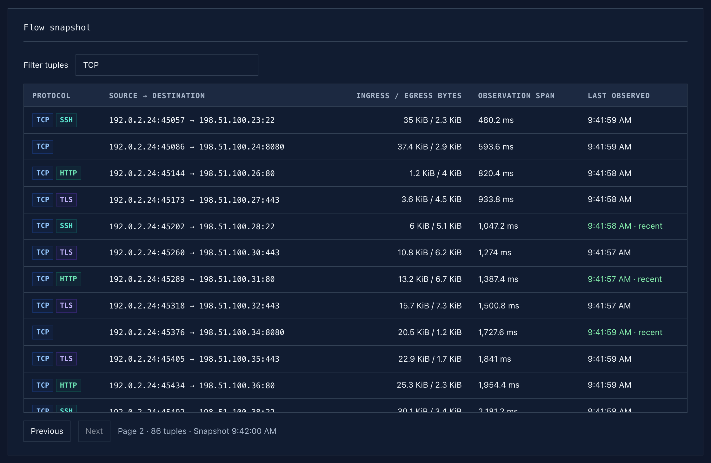

<p align="center">
  
</p>

# Argus

Argus observes directional IPv4 TCP and UDP tuples at TCX ingress and egress on one Linux interface. It reports traffic counters through Prometheus and publishes recent flow details in a web dashboard.

## Visual Diagnostics Dashboard

These screenshots show an earlier dashboard with process and latency fields.

### Overview Console

<p align="center">
  
</p>

### Stream Inspection Console

<p align="center">
  
</p>

## Run locally

Use Linux 6.6 or newer with TCX support and permission to load BPF programs and attach them to the interface. Build with Go 1.25 or later. The release build uses Go 1.27.4 and the checked-in BPF objects.

```sh
make build
sudo ./bin/argus --interface eth0
curl -fsS http://127.0.0.1:9090/readyz
```

Open [the dashboard](http://127.0.0.1:9090/) or scrape [the Prometheus endpoint](http://127.0.0.1:9090/metrics). The default listener accepts local connections only. For remote clients, keep Argus on loopback and terminate TLS and authentication at a reverse proxy on the host. Grant access to `/metrics` to the scraper and restrict dashboard and API access to authorized operators. An explicit non-loopback `listen_addr` makes all HTTP routes reachable there. Use it only where an external access control enforces that boundary.

### Containers

Run Docker Compose on a Linux host that supports TCX. Set `ARGUS_INTERFACE` in the shell or copy and edit `.env.example`.

```sh
docker compose up --build
```

The Compose file and [Kubernetes DaemonSet](deploy/kubernetes/daemonset.yaml) use the host network with `BPF` and `NET_ADMIN` capabilities. Adjust `NODE_INTERFACE` for the DaemonSet and load `argus:local` onto each node or set the image to a trusted release image. Create the `monitoring` namespace before applying the manifest. For remote scraping, use an authenticated TLS proxy on each node. The manifest keeps the agent private and the kubelet probes loopback.

Kernel configuration, container runtime and seccomp policy determine whether these permissions suffice. Prefer a compatible runtime profile that allows the required BPF commands. Docker's `--privileged` mode is an explicit compatibility option for isolated test hosts. It grants extensive access to the host kernel and devices.

### Configuration

Settings are applied in order from built-in defaults, `configs/default.yaml` or the file passed with `--config`, then environment. For each variable, the process environment overrides `.env` in the working directory. `--interface` overrides the selected interface. An explicitly requested YAML file must exist. Unknown YAML fields and malformed durations are errors.

| YAML setting | Environment | Default and bounds |
| --- | --- | --- |
| `agent.interface` | `ARGUS_INTERFACE`, legacy `INTERFACE` | `eth0`, Linux interface name |
| `agent.collect_interval` | `ARGUS_COLLECT_INTERVAL` | `5s`, 100ms to 5m |
| `agent.map_capacity` | `ARGUS_MAP_CAPACITY` | `100000`, 1 to 100,000 tuples per window |
| `prometheus.listen_addr` | `ARGUS_LISTEN_ADDR`, legacy `PORT` | `127.0.0.1:9090`, explicit IP or `localhost` and port |
| `logging.level` | `ARGUS_LOG_LEVEL` | `info` |
| `logging.format` | `ARGUS_LOG_FORMAT` | `json` or `text` |

The preferred variables take precedence over their aliases. `PORT` changes the port on IPv4 loopback. Replace legacy `:9090` binds with an explicit address, normally `127.0.0.1:9090`. `cache_ttl` and `ARGUS_CACHE_TTL` remain accepted for old configurations and have no runtime effect.

## Flow details and health

Each collection seals one flow window and opens a fresh bounded map. Flows with no new traffic age out at rotation. A row identifies a directional tuple within a collection window and includes its last-seen time and observation span. Tuple reuse within a window can share a row. Detail retention and L7 labels are best-effort. [Flow lifecycle and accounting design](docs/flow-lifecycle.md)

- `GET /api/flows?limit=100&q=TCP` returns a deterministically ordered page. The default limit is 100 and the maximum is 1,000. Filter by exact IPv4 address, exact port, or transport/L7 label prefix. Pass `next_cursor` back with the same filter. Cursors retain their generation across one newer publication and return HTTP 410 after expiration. Malformed queries return HTTP 400 and oversized queries return HTTP 414. `generated_at` is the collection time.
- `GET /api/stats` reports retained tuples, tuples with recent traffic, eligible observation totals, collection age, and traffic-rate history. Rate uses counter deltas and actual elapsed time. First sample, counter reset, failed collection, and the first sample after failure are gaps. A healthy idle interval reports zero bytes per second.
- `GET /healthz` checks HTTP liveness. `GET /readyz` requires both TCX attachments and a successful collection within three collection intervals. Empty successful collections are healthy. Confirmed interface disappearance makes the agent unready.

Argus labels recognizable HTTP, TLS handshake, SSH and DNS payloads from bytes available in one socket buffer. Flow ownership, RTT, and receiver packet loss are unavailable. Socket attribution, IPv6/VLAN coverage, and multiple interfaces are separate follow-ups.

## Metrics

| Metric | Source and meaning |
| --- | --- |
| `network_observed_bytes_total`, `network_observed_packets_total` | In-process cumulative eligible TCX observations, independent of detail admission and rotation. Labels are interface, transport protocol and direction. The API rate uses these counters. |
| `network_bytes_total`, `network_packets_total` | Legacy snapshot-accounted detail totals by interface, transport, L7 label and direction. Each successful window adds its retained observations under its final classification. Earlier publications keep their original labels. Use observation counters for complete eligible traffic totals. |
| `network_active_connections` | Retained tuples with observations in the latest successful window, by interface, transport and L7. The gauge describes directional tuples. |
| `network_flow_map_entries`, `network_flow_map_capacity` | Last published occupied entries and configured capacity. |
| `network_flow_update_failures_total` | Packet observations whose detail could not be retained. |
| `network_observation_skips_total`, `network_observation_accounting_failures_total` | Unsupported or malformed hook observations and failures to account for an eligible observation. |
| `network_collection_duration_seconds`, `network_collection_map_read_duration_seconds`, `network_collection_errors_total` | Collection and map-walk latency, and errors grouped by stage. |
| `network_collection_last_success_timestamp_seconds`, `network_collection_lag_seconds`, `network_collection_overruns_total`, `network_flow_generations_discarded_total` | Publication time, scheduling delay, collection overruns, and sealed detail windows discarded after unsuccessful collection. |

Bytes count `skb->len` and packets count hook observations. Kernel offloads, hook placement, and delivery beyond the hook affect comparison with receiver counts.

```promql
sum by (direction) (rate(network_observed_bytes_total[5m]))
```

## Validation and performance

Run `make check-generated` to check both endian objects and Go bindings. `make generate-pinned` regenerates them with Zig 0.15.2, libbpf 1.5.0 headers, and the module's pinned bpf2go. Both commands verify downloaded archives and normalize debug paths. Building from the checked-in objects requires only Go.

At 100,000 synthetic tuples, median userspace collection and publication fell from 36.34 ms to 26.91 ms and allocated bytes per operation fell from 100.1 MB to 18.0 MB. In isolated ARM64 veth tests, Argus counted all 11,900 eligible UDP observations with a 1,000-entry detail cap. Five short attached-to-attached trials showed similar throughput at the offered load, lower RSS, and higher agent CPU.

See the [release measurements](benchmarks/results/2026-11-17-flow-lifecycle/report.md), [benchmark instructions](benchmarks/README.md), and [historical ARM64 results](benchmarks/results/2026-11-15-637ddfa/report.md). Portable Go tests, Linux builds, and the explicitly gated TCX kernel tests cover different parts of the release.
