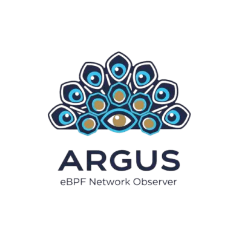
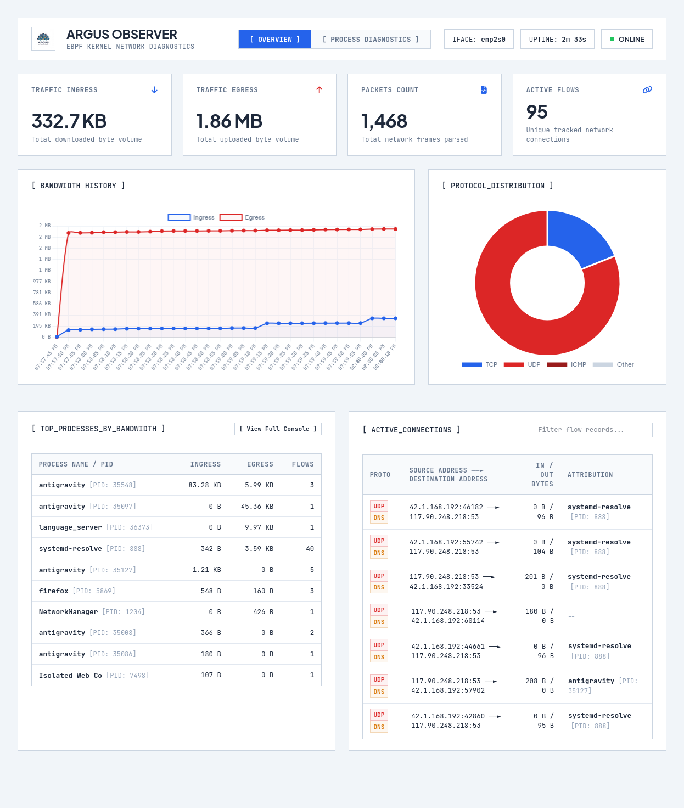

<p align="center">
  
</p>

# Argus eBPF Kernel Network Observability & DPI Agent

<p align="center">
  <a href="https://hub.docker.com/r/shudhanshusingh/argus">
    
  </a>
  
</p>

Argus is a high-performance, kernel-level network observability and **L7 Deep Packet Inspection (DPI)** agent for Kubernetes and Linux nodes. It uses **eBPF TC (Traffic Control) classification programs** to capture network flows at line rate with zero packet sampling, executes lightweight signature analysis inside the kernel to snoop L7 protocols (like TLS, HTTP, DNS, and SSH), enriches them with process and container metadata, and exposes metrics via Prometheus and a real-time web dashboard.

```
┌────────────────────────────────────────────────────────────────────────┐
│                              Linux Kernel                              │
│                                                                        │
│  Network Interface (enp2s0 / eth0)                                     │
│       │                                                                │
│       ▼                                                                │
│  TC Ingress Hook ──► parse_ipv4() ──► detect_l7() (DPI Signature) ──►  │
│       │                                    │                           │
│  TC Egress Hook  ◄─────────────────── update_flow()                    │
│                                            │                           │
│                              flow_map (BPF_MAP_TYPE_HASH)              │
└────────────────────────────────────────────┼───────────────────────────┘
                                             │  BPF map read (syscall)
┌────────────────────────────────────────────▼───────────────────────────┐
│                            Argus Go Agent                              │
│                                                                        │
│  FlowCollector ──► ProcessEnricher ──► Exporters                       │
│  (every 5s)        (/proc/pid/comm)   ├── Prometheus (/metrics)        │
│                    (/proc/pid/cgroup) └── Web Dashboard (:9090)        │
└────────────────────────────────────────────────────────────────────────┘
```

---

## Core Features

- **Zero-Copy Kernel Capture** : Attaches directly to the kernel's `clsact` qdisc Traffic Control boundary to capture packets before they hit socket buffers.
- **L7 Deep Packet Inspection (DPI)** : Runs a lockless C parser inside the eBPF VM to inspect payloads for structural L7 protocol signatures:
  - **`TLS / HTTPS`**: Identifies TLS Handshake records (`0x16 0x03` signatures).
  - **`HTTP`**: Detects unencrypted methods (`GET`, `POST`, `PUT`, `DELETE` signatures).
  - **`SSH`**: Detects standard protocol identification (`SSH-` signatures).
  - **`DNS`**: Dissects domain query packets on port 53.
- **Process & Container Attribution** : Dynamically parses VFS `/proc/<pid>/comm` and container cgroup paths to map kernel-level packets to specific host PIDs, process names, and Docker/Kubernetes container IDs.
- **Visual Diagnostics Dashboard** : A real-time web console displaying high-throughput talkers, interactive connection maps, and L7 badge overlays.
- **Enterprise Prometheus Exporter** : Custom Prometheus Collector exposing `network_bytes_total`, `network_packets_total`, and `network_active_connections` with dynamic `{protocol}` and `{l7_protocol}` labels.
- **CO-RE (Compile Once – Run Everywhere)** : Relies on raw kernel BTF metadata relocation, enabling a single pre-compiled `.o` binary to run across different Linux kernels (5.15+) without recompilation.

---

## eBPF Kernel L7 Signature Engine

Below is the optimized C signature detection routine that runs directly inside the kernel, bounds-checked and approved by the BPF verifier:

```c
/* inspects packet payload for protocol-specific byte patterns */
static __always_inline __u8 detect_l7(struct __sk_buff *skb, __u8 protocol,
                                     __u32 ip_hdr_len, __u16 src_port, __u16 dst_port)
{
    __u16 sport = bpf_ntohs(src_port);
    __u16 dport = bpf_ntohs(dst_port);
    __u32 payload_offset = 0;

    if (protocol == PROTO_UDP) {
        payload_offset = sizeof(struct ethhdr) + ip_hdr_len + 8;
    } else if (protocol == PROTO_TCP) {
        struct tcphdr tcph;
        __u32 tcp_offset = sizeof(struct ethhdr) + ip_hdr_len;
        if (bpf_skb_load_bytes(skb, tcp_offset, &tcph, sizeof(tcph)) < 0) return L7_UNKNOWN;
        __u32 tcp_hdr_len = tcph.doff * 4;
        if (tcp_hdr_len < 20) return L7_UNKNOWN;
        payload_offset = sizeof(struct ethhdr) + ip_hdr_len + tcp_hdr_len;
    } else {
        return L7_UNKNOWN;
    }

    __u8 buf[4] = {0};
    if (bpf_skb_load_bytes(skb, payload_offset, buf, sizeof(buf)) < 0) {
        /* Empty payloads (like TCP ACKs) fall back to port guessers */
        if (sport == 53 || dport == 53) return L7_DNS;
        return L7_UNKNOWN;
    }

    /* 1. HTTP: Look for standard requests */
    if ((buf[0] == 'G' && buf[1] == 'E' && buf[2] == 'T' && buf[3] == ' ') ||
        (buf[0] == 'P' && buf[1] == 'O' && buf[2] == 'S' && buf[3] == 'T') ||
        (buf[0] == 'H' && buf[1] == 'T' && buf[2] == 'T' && buf[3] == 'P')) {
        return L7_HTTP;
    }

    /* 2. TLS: SSLv3/TLSv1 Handshake (0x16 0x03) */
    if (buf[0] == 0x16 && buf[1] == 0x03 && (buf[2] == 0x01 || buf[2] == 0x02 || buf[2] == 0x03)) {
        return L7_TLS;
    }

    /* 3. SSH: Protocol magic greeting */
    if (buf[0] == 'S' && buf[1] == 'S' && buf[2] == 'H' && buf[3] == '-') {
        return L7_SSH;
    }

    return L7_UNKNOWN;
}
```

---

## Visual Diagnostics Dashboard

Argus features an integrated, real-time web observer console using light-mode glassmorphism styling to visualize global throughput charts, active process hierarchies, and L7 badge distributions:

### Overview Console
<p align="center">
  
</p>

### Stream Inspection Console
<p align="center">
  
</p>

---

## Prometheus Telemetry Schema

Argus generates highly granular, multi-label metrics allowing deep queries of network patterns:

| Metric | Type | Labels | Description |
|--------|------|--------|-------------|
| `network_bytes_total` | Counter | `interface`, `protocol`, `l7_protocol`, `direction` | Monotonically increasing counter of bytes |
| `network_packets_total` | Counter | `interface`, `protocol`, `l7_protocol`, `direction` | Monotonically increasing counter of packets |
| `network_active_connections` | Gauge | `interface`, `protocol`, `l7_protocol` | Gauges unique connections in last interval |

### Powerful PromQL Examples:
```promql
# Graph Ingress TLS traffic throughput (bytes/sec)
sum(rate(network_bytes_total{direction="ingress", l7_protocol="TLS"}[5m]))

# Contrast secure (HTTPS/TLS) vs plain text (HTTP) traffic counts
sum by (l7_protocol) (rate(network_bytes_total{protocol="TCP"}[5m]))

# Monitor active DNS connection gauges
network_active_connections{l7_protocol="DNS"}
```

---

## Quick Start & Installation

### Prerequisites
- Clang $\ge$ 12 & LLVM
- Linux Kernel headers (`apt install linux-headers-$(uname -r)`)
- libbpf developer headers (`apt install libbpf-dev`)
- Go $\ge$ 1.21

### 1. Build and Run
```bash
# Clone the repository
git clone https://github.com/sudhanshu-singh/argus.git && cd argus

# Generate vmlinux.h from BTF
make vmlinux

# Compile C kernel-space programs and generate Go bpf2go bindings
make generate

# Compile the Go agent binary
make build

# Start the agent on your network interface (e.g., enp2s0 or eth0)
sudo ./bin/argus --interface enp2s0
```

### 2. Build and Run with Docker (Recommended)
If you prefer not to install the eBPF build toolchain (`clang`, `llvm`, `libbpf-dev`, `go`) on your host, you can run Argus fully containerized using **Docker** or **Docker Compose**.

Because Argus attaches directly to the host's physical network queue and maps connection PIDs to host processes, it requires privileged host access (`--privileged`, `--network host`, and `--pid host`).

#### Option A: Docker Compose (Easiest)
Make sure you have created your `.env` file from `.env.example` and set your active interface (`ARGUS_INTERFACE=eth0` or `ARGUS_INTERFACE=enp2s0`):

```bash
# Build the image and run the agent in the foreground
sudo docker compose up --build

# Run in the background (detached)
sudo docker compose up -d --build

# Stop the agent
sudo docker compose down
```

#### Option B: Docker CLI
You can pull and run the pre-built image directly from Docker Hub:

```bash
# Run the pre-built eBPF agent container from Docker Hub
sudo docker run -d \
  --name argus \
  --privileged \
  --network host \
  --pid host \
  -v /sys:/sys:ro \
  -v /proc:/proc:ro \
  -v $(pwd)/configs:/app/configs:ro \
  -e ARGUS_INTERFACE=eth0 \
  -p 9090:9090 \
  --restart unless-stopped \
  shudhanshusingh/argus:latest
```

Alternatively, you can build and run it locally:
```bash
# Build the image locally
docker build -t argus:latest .

# Run the local image
sudo docker run -d \
  --name argus \
  --privileged \
  --network host \
  --pid host \
  -v /sys:/sys:ro \
  -v /proc:/proc:ro \
  -v $(pwd)/configs:/app/configs:ro \
  -e ARGUS_INTERFACE=eth0 \
  -p 9090:9090 \
  --restart unless-stopped \
  argus:latest
```

### 3. Access the Consoles
*   **Web Diagnostics UI:** `http://localhost:9090`
*   **Prometheus Metrics Endpoint:** `http://localhost:9090/metrics`

### 4. Verify L7 Detection (DPI Test)
To watch the eBPF kernel program dynamically capture unencrypted HTTP payloads in real-time, trigger a plain HTTP request in a separate terminal:
```bash
curl http://neverssl.com
```
Check your dashboard or stdout JSON logs you will instantly see a flow attributed to `curl` with protocol `TCP` and L7 Protocol marked as **`HTTP`**!

---

## Project Structure

```
argus/
├── bpf/
│   ├── include/
│   │   ├── common.h          # Shared structs (flow_key_t, flow_metrics_t)
│   │   └── vmlinux.h         # Relocatable kernel type mapping
│   └── programs/
│       └── network_stats.c   # eBPF C program (Ingress/Egress TC hooks + DPI Engine)
├── cmd/
│   └── network-observer/
│       └── main.go           # Daemon entry point & YAML configuration parser
├── configs/
│   └── default.yaml          # Agent intervals & network server configs
├── deploy/
│   └── kubernetes/
│       └── daemonset.yaml    # Kubernetes DaemonSet deployment spec
├── internal/
│   ├── bpf/
│   │   └── loader.go         # TC link attachments, qdisc and BPF map loader
│   ├── collector/
│   │   └── flow_collector.go # Map iterator, L7 name mapper, JSON formatter
│   ├── config/
│   │   └── config.go         # Struct configuration loader
│   ├── enricher/
│   │   └── process.go        # Thread-safe VFS /proc parser & PID cache
│   └── exporter/
│       ├── exporter.go       # Exporter interface
│       └── prometheus.go     # Custom Prometheus Collector HTTP Server
│   └── api/
│       └── dashboard.html    # Interactive Glassmorphism Dashboard UI
├── Makefile
├── go.mod
└── README.md
```

---

## Kubernetes Deployment Guide

To observe network flows cluster-wide, Argus is deployed as a **DaemonSet** so that exactly one monitoring agent pod runs on every Linux node in your cluster.

### 1. Required Privileges & Mounts
Because eBPF interacts directly with host-level sockets, network interfaces, and kernel subsystems, the DaemonSet requires specific security privileges and host directory mounts:
*   **`securityContext.privileged: true`** (or `CAP_BPF` + `CAP_NET_ADMIN` + `CAP_SYS_ADMIN` capabilities) to load Traffic Control links and access kernel rings.
*   **Host Network (`hostNetwork: true`):** Runs the pod in the node's network namespace to attach hooks directly to host physical interfaces (like `eth0` or `bond0`).
*   **Host `/sys/fs/bpf` Volume:** Mounts the host's BPF virtual filesystem so maps can be inspected or persisted.
*   **Host `/proc` Volume:** Mounts the host's virtual `/proc` filesystem so the agent can correctly correlate connection flows with PIDs and container names running outside the pod's container.

### 2. Deploying Argus
Deploy the pre-configured DaemonSet and RBAC authorization resources to your cluster:
```bash
# Create the monitoring namespace
kubectl create namespace monitoring

# Apply the DaemonSet configurations
kubectl apply -f deploy/kubernetes/daemonset.yaml
```

### 3. Verify the Deployment
```bash
# Verify pods are running on every cluster node
kubectl get pods -n monitoring -l app=argus -o wide

# Inspect the logs of an active agent pod
kubectl logs -n monitoring -l app=argus --tail=100 -f
```

---

## eBPF Architecture Notes

- **TC Hook vs XDP:** While XDP runs faster at the driver level, Traffic Control (TC) has access to the full socket buffer struct (`sk_buff`), allowing bidirectional traffic capture, native VLAN/port support, and deep packet access to socket context—making it perfect for end-to-end container observability.
- **BPF Verifier Compliance:** Fully compliant with kernel safety limits. BPF stack usage is optimized, all loops are bounded, helper function calls are inlined, and any payload memory read is bounds-checked via safe pointer arithmetic and verified before execution.

---

## License

Argus is licensed under the Apache 2.0 License.
